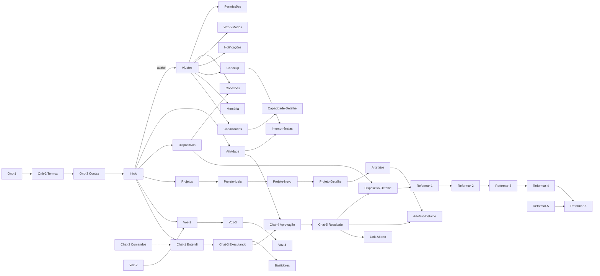

# AURA AI v6 — plano "telas sem Termux"

Branch `claude/telas-sem-termux` (base `fe7c7b4`). Especificação: `AGENTS.md`, `docs/PROMPT_SESSAO_LOCAL.md`, `docs/MATRIZ_DE_TESTES.md`,
`docs/CONSTRAINTS.md` (seção "App Android"), `docs/design/INVENTARIO-2026-10-27.md` (o que falta, tela a tela).
Este arquivo é a lista de tarefas: ao concluir, marque `[x]` e escreva a evidência na linha de baixo. Registro de cada bloco em `docs/REGISTRO.md`.

## Objetivo e definição de "pronto"
APK v6 que **nunca fica morto** (regra nº 1) e instala por cima do v5 sem perder dados nem login. "Pronto" = matriz A–F de `docs/MATRIZ_DE_TESTES.md`
toda marcada, cada marca com evidência (saída de teste, print, logcat). Nenhum APK de entrega antes disso. APK de teste interno fica no emulador, nunca no chat.

## Premissas e decisões (Ruling)
1. Implementadores em paralelo, cada um em worktree próprio e com pacote próprio; merge serial pelo controlador; Gradle serializado por `scripts/gw.sh`.
   O dono pediu paralelo; o padrão da skill é sequencial. Custo se errado: conflito em `Routes.kt`/`AuraApp.kt` (resolvido no merge).
2. Sem tela "em construção". Rota ainda não feita fica em `pending` no teste do grafo (T5); o portão final (T17) exige `pending` vazio.
3. Tela que depende de dado que o motor não tem mostra o que existe e diz o que falta. Nunca inventa dado (nada de Fake em produção).
4. Permissões só sob demanda, com explicação antes do pedido do sistema. `MANAGE_EXTERNAL_STORAGE` sai do manifesto. Custo se errado: compartilhar arquivo com o Termux fica mais limitado.
5. Teste de motor Python: 12 falhas + 1 erro já existem no Windows (ambiente). T3 compara o conjunto de falhas antes/depois; o motor completo roda no Linux pela sessão da nuvem.
6. Push na branch só depois de GREEN. PR para `main` só com suíte e build verdes.
7. Os dois emuladores autorizados pelo dono: `emulator-5554` (Galaxy_S23_Auto, Android 17, 1080×2340) = celular com o AURA; `emulator-5556` (Taytech_M550Pro, Android 11, 1280×720) = multimídia controlada pelo AURA.
   O celular S23 físico e a central física não entram. Ao terminar: desinstalar AURA/Termux de teste e restaurar qualquer ajuste global mexido.

## Regras para toda tarefa (implementador e revisor)
- Trabalhe no worktree indicado. Commits pequenos, em português, terminando com a linha `Co-Authored-By: Claude Sonnet 5.5 <noreply@anthropic.com>`. Não faça `push`.
- TDD de verdade: escreva o teste, rode e veja falhar (RED, cole a saída no relatório), implemente, veja passar (GREEN). Compose UI Test com Robolectric na JVM para clicar em tudo.
- Gradle só por `bash scripts/gw.sh --dir <worktree>/android <tarefas> --offline` (um por vez na máquina; leia `EXIT=`/`BUILD` do log). Em iteração rode só o teste focado (`--tests`); a suíte completa uma vez antes de cada commit.
- Qualidade: `docs/CONSTRAINTS.md` seção "App Android" (sem novo `@Suppress`/`@Ignore`/`TODO()`, sem `onClick = {}`, nenhum segredo em log, alvo ≥ 44 dp). Não enfraqueça a barra para passar.
- Regra nº 1: sem Termux, sem motor ou sem internet, toda tela e todo botão abrem; o que depende do motor mostra mensagem clara e UMA ação. Nunca tela em branco, spinner infinito, botão mudo.
- Design é fiel: leia `docs/design/telas/<tela>.dc.html` e a imagem `.superpowers/design-png/<tela>.png` (390×844; gere com `scripts/render-design.sh <filtro>` se faltar). Um botão principal por tela, verbo + objeto, erro diz o que fazer, tela vazia convida a agir.
- Textos em português do Brasil, simples. Termo técnico só com uma frase explicando.
- Fique dentro do seu pacote. Os pontos compartilhados (`ui/nav/Routes.kt`, `AuraApp.kt`, `MainActivity.kt`, `UiEngine.kt`) só ganham linhas de registro; não reestruture.
- Não despache subagentes. Relatório completo no arquivo indicado; resposta final com no máximo 15 linhas.

## Grafo (mapa de ligações)
Fonte de verdade em código: `ui/nav/Routes.kt` (T5); o teste `NavGraphTest` compara com os arquivos de `docs/design/telas` e com `Fluxo-do-usuario.dc.html`.

Dependências entre tarefas: T1 → T4, T5, T13 · T2 → T7, T19 · T3 → T4, T11 · T4 → T8, T11, T12, T13 · T5 → T6…T16 · T6 → T8 · T7 depende de T2 e T5 · T17 depois de T6…T16 · T18 depois de T17 · T19 depois de T18.
Ondas: **1** = T1, T2, T3 (em paralelo) · **2** = T4 e T5 (em seguida, em série curta) · **3** = T6…T16 (até 5 por vez) · **4** = T17 → T18 → T19.

## Checkpoints
- **CP1** (fim da onda 1): suíte JVM verde com a camada offline; manifesto novo montado; motor com `DELETE /v1/memory`. Matriz A (parte JVM) e C (manifesto).
- **CP2** (fim da onda 2): app abre em qualquer estado, banner "Motor desligado · Iniciar o motor" visível, grafo com todas as rotas registradas (`pending` = telas ainda não feitas).
- **CP3** (fim da onda 3): `pending` vazio; cada tela renderiza offline na JVM; matriz D.
- **CP4**: `OfflineMatrixTest` + `ClickEverythingTest` verdes; lint sem erro; matriz E.
- **CP5**: emulador S23 (v5 → v6 por cima; sem Termux; com Termux) e Taytech (alvo do ADB) com prints e logcat; matrizes B, C, F.
- **CP6**: build final, entrega em `C:\Users\hugov\Desktop\DESKTOP LIVE\auraai-v6.apk`, PR.

## O que falta provar (cada item tem comando ou lugar da evidência)
| # | Prova | Como | Estado |
|---|---|---|---|
| P1 | Suíte JVM toda verde | `bash scripts/gw.sh :app:testDebugUnitTest --offline` | ⏳ |
| P2 | Toda rota abre offline sem exceção | `OfflineMatrixTest` (T17) | ⏳ |
| P3 | Nenhum botão morto | `ClickEverythingTest` (T17) | ⏳ |
| P4 | Grafo completo: 40 telas, arestas, `pending` vazio | `NavGraphTest` (T5/T17) | ⏳ |
| P5 | Manifesto sem permissão de risco e sem cleartext global | `aapt2 dump permissions`, teste de manifesto, Lint | ⏳ |
| P6 | Fila offline: cada pedido enviado uma única vez | `OfflineFirstGatewayTest` (T1) | ⏳ |
| P7 | v6 instala por cima do v5 e mantém dados/login | emulador S23, marcador gravado antes | ⏳ |
| P8 | Passeio por todas as abas SEM Termux, sem fechar | emulador S23, prints + logcat sem `FATAL` | ⏳ |
| P9 | Passeio COM Termux: instalar, parear, motor online, tarefa roda | emulador S23 + `com.termux_1021.apk` | ⏳ |
| P10 | Controlar a multimídia por ADB (capturar tela, instalar app) | S23 → Taytech (`10.0.2.2:5557`) | ⏳ |
| P11 | Fidelidade: print do app × print do design, 40 telas | `docs/design/CONFERENCIA.md` (T17/T18) | ⏳ |
| P12 | Leve: tamanho do APK, partida a frio, memória | `am start -W`, `dumpsys meminfo`, tamanho | ⏳ |
| P13 | Motor completo no Linux | sessão da nuvem (PR #2) no commit final | ⏳ |

## Tarefas

## Task 1: Camada offline (GREEN dos testes já escritos)
Descrição: os três arquivos de teste em `android/app/src/test/java/ai/aura/app/offline/` (`LocalStoreTest`, `EngineLinkTest`, `OfflineFirstGatewayTest`) são a especificação e hoje não compilam (RED). Crie o código de produção em `android/app/src/main/java/ai/aura/app/offline/`.
- `LocalStore(dir)`: JSON em disco, gravação atômica (arquivo temporário + rename), arquivo corrompido ou sobra de gravação interrompida devolve o último valor bom ou `null`, nomes validados (sem `/`, `..`, vazio).
- `EngineLink`: `StateFlow<LinkState>` (Unknown, Online, Starting, Offline(NoTermux | NoPermission | NoToken | EngineStopped)) com as prioridades que `EngineLinkTest` fixa; `TermuxProbe`; `EngineUnreachableException : IOException` com `OfflineReason`.
- `OfflineFirstGateway(delegate, store, link)`: leitura com cache (mostra o último dado bom do disco quando o motor não responde), fila local de pedidos (`JobStatus.WaitingEngine`, id `local_<requestId>`), envio em ordem e exatamente uma vez (Mutex; rotear e depois enviar), histórico de rejeitados, estado do link reagindo a `connection.lost` / `connection.restored`.
- Alterar: `ui/engine/UiEngine.kt` (`JobStatus.WaitingEngine("waiting_engine")`) e corrigir os `when` exaustivos que quebram: `ActivityModels.kt:26-31` e `:34-42`; `ChatModels.kt:104-110` e `:112-120`; `ChatParts.kt:240-248`; `ProjectModels.kt:52-59`; `ProjectDetailScreen.kt:220-228` (revise também os `when` com `else` de `ChatParts.kt:229-236, 304-329, 370-379` e `ActivityModels.kt:66-74`: o `else` não pode esconder o novo estado). `integration/TermuxBridge.kt` passa a implementar `TermuxProbe`. `integration/AuraEngineClient.kt` lança `EngineUnreachableException` (`NoToken` sem credencial; `EngineStopped` em recusa ou tempo esgotado), mantendo `IOException`.
- Fora de escopo: ligar na UI (T5) e emitir `connection.lost/restored` no `RealEngineGateway` (T4).
Aceite:
- [ ] `bash scripts/gw.sh :app:testDebugUnitTest --tests "ai.aura.app.offline.*" --offline` verde; saída do RED (falha de compilação) colada no relatório.
- [ ] Suíte completa `:app:testDebugUnitTest --offline` verde e `:app:assembleDebug --offline` compila.
- [ ] Nenhum novo `@Suppress`/`@Ignore`/`TODO()`.
Depende de: nada. Arquivos: `offline/*.kt` (novos), `ui/engine/UiEngine.kt`, os `when` listados, `TermuxBridge.kt`, `AuraEngineClient.kt`. Tamanho: M. Worktree: `wt-t1`.

## Task 2: Manifesto, ícone e segurança do APK
Descrição: o APK precisa parecer e ser um app sério para o Android e para o dono. Hoje: ícone padrão (robô), `usesCleartextTraffic="true"` global, permissões demais e a de "gerenciar todos os arquivos".
- Ícone adaptável com camada monocromática (`res/mipmap-anydpi-v26/ic_launcher.xml` e `ic_launcher_round.xml`) com o orbe do design; `label="AURA AI"`; `icon`/`roundIcon` no manifesto.
- `network_security_config.xml`: texto puro só para `127.0.0.1` e `localhost`; tirar `usesCleartextTraffic` global.
- `allowBackup="false"` com regras de extração (token é preso ao Keystore do aparelho).
- Permissões: listar o que o código usa de verdade (`grep`), remover o que não tem função (câmera, dispositivos próximos, `MANAGE_EXTERNAL_STORAGE` e o que mais não tiver uso), manter só o necessário (INTERNET para o motor em 127.0.0.1, `com.termux.permission.RUN_COMMAND`, microfone, notificações, instalar pacotes se o fluxo "Instalar APK" usar). Cada uma entra em `docs/PERMISSOES.md` (tabela: permissão, por que, quando pede, o que acontece se negar).
- Release: `isMinifyEnabled = true` + `isShrinkResources = true` com regras de manutenção; não depurável; MESMA chave de assinatura do v5 (assinar com a chave de debug que já existe) para instalar por cima. Não mude `applicationId`.
- `exported` correto; `queries` só para o pacote do Termux.
Aceite:
- [ ] Teste de manifesto (Robolectric ou parser) falha se aparecer permissão fora da lista de `docs/PERMISSOES.md`.
- [ ] `aapt2 dump permissions` do APK debug e do release bate com `docs/PERMISSOES.md`; `aapt2 dump badging` mostra ícone adaptável e não depurável (release).
- [ ] `bash scripts/gw.sh :app:lintDebug --offline` sem erro novo (se o Lint não estiver disponível, diga e registre).
- [ ] Suíte e `assembleDebug` verdes. O release só é montado para conferir (`assembleRelease`), nunca entregue.
Depende de: nada. Arquivos: `AndroidManifest.xml`, `res/xml/*`, `res/mipmap-anydpi-v26/*`, `res/drawable/ic_launcher_*.xml`, `app/build.gradle.kts` (bloco release), `proguard-rules.pro`, `docs/PERMISSOES.md`. Tamanho: M. Worktree: `wt-t2`.

## Task 3: Motor — esquecer a memória e dar tipo ao que ele lembra
Descrição (Python, `engine/`): hoje `/v1/memory` só lê e grava. A tela Memória (T11) precisa de "Esquecer" e "Esquecer tudo".
- `DELETE /v1/memory/{id}` → 204 (ou 404); `DELETE /v1/memory` → `{"deleted": n}`; ambos com token (401 sem ele, como as outras rotas).
- Item de memória: `{id, kind, text, source, createdAt}` com `kind ∈ preference|project|device|rule` (padrão `preference`); `POST` aceita `kind` e `source` opcionais; arquivo antigo (sem `id`/`kind`) é lido e completado sem perder nada (gravação atômica com o helper que já existe).
- Atualizar `docs/ENGINE_CONTRACT.md`. Teste novo em `engine/tests/`.
Aceite:
- [ ] `cd engine && python -m unittest tests.test_memory_forget -v` verde, com RED antes.
- [ ] Antes e depois: a lista de falhas do `python -m unittest` completo é a mesma (12 falhas + 1 erro de ambiente do Windows; não conserte, não esconda).
- [ ] Nenhum segredo em log ou fixture.
Depende de: nada. Arquivos: `engine/aura_engine/*.py` (memória e servidor), `engine/tests/test_memory_forget.py`, `docs/ENGINE_CONTRACT.md`. Tamanho: S. Worktree: `wt-t3`.

## Task 4: Gateway ampliado e tolerante
Descrição: a UI precisa de dados que a interface `EngineGateway` não expõe e o `RealEngineGateway` é frágil (auditoria 27/10).
- Interface + `RealEngineGateway` + `OfflineFirstGateway` (repassa/cacheia) + `FakeEngineGateway` (só para teste/preview, movido para `src/test`/`src/debug`): `memory()`, `forgetMemory(id)`, `forgetAllMemory()`, `skills()`, `health()`, `usage()`. Tipos novos em `ui/engine/UiEngine.kt`.
- `asJob` tolerante: status desconhecido → `Failed` com `errorCode = "unknown_status:<valor>"`; risco desconhecido → `Critical`; job malformado é descartado sem derrubar a lista. Eventos: `try/catch` por evento e o cursor SEMPRE avança; emitir `connection.lost` e `connection.restored` (ids negativos únicos); cursor refeito quando o motor reinicia (ids menores que o cursor).
- Erros do motor (`AuraEngineException`): 404/409 levam a mensagem do motor para a UI (hoje vira "erro genérico"); `requestId` único na instalação de CLI; `routedRequests` limitado (200).
- Para testar sem rede: extrair `interface EngineApi` (implementada por `AuraEngineClient`) e testar o `RealEngineGateway` com um falso.
- Remover `FakeEngineGateway()` como padrão de `AuraApp.kt:100`; `ExampleData` e Fake saem de `src/main`.
Aceite:
- [ ] Testes novos: job desconhecido não derruba a lista; evento ruim não trava o polling; reinício do motor refaz o cursor; 409 mostra a mensagem do motor; `connection.*` emitidos.
- [ ] Suíte completa e `assembleDebug` verdes; `grep -rn "FakeEngineGateway\|ExampleData" android/app/src/main` sem resultado.
Depende de: T1 (e do contrato de T3). Arquivos: `ui/engine/UiEngine.kt`, `integration/*`, `offline/OfflineFirstGateway.kt`, `AuraApp.kt` (só o default). Tamanho: M. Worktree: `wt-t4`.

## Task 5: Esqueleto de navegação, banner global e ligação do app
Descrição: uma rota para cada tela do design e um banner que mostra o estado do motor em qualquer tela.
- `ui/nav/Routes.kt`: registro (`id`, arquivo do design, aba, `needsEngine`, arestas de saída); `ScreenRegistry` (id → composable); pilha de navegação salva (`rememberSaveable`, só textos); botão Voltar do sistema desempilha. Abas do design: Início, Projetos, Dispositivos, Atividade; Ajustes abre pelo avatar. Telas ainda não feitas ficam em `pending` (sem "em construção").
- `NavGraphTest`: todo arquivo de `docs/design/telas` (menos os 5 de documentação) tem rota; toda aresta aponta para rota existente; tudo alcançável a partir das entradas; imprime o `pending`.
- `EngineBanner` global ("Motor desligado" + UMA ação por motivo: NoTermux → Instalar o Termux; NoPermission → Permitir; NoToken → Conectar; EngineStopped → Iniciar o motor; Starting → "Iniciando…" sem botão), ligado ao `EngineLink`; a ação chama um callback (a implementação real é do T6).
- `MainActivity`: `OfflineFirstGateway(RealEngineGateway(...), LocalStore(filesDir/"aura"), EngineLink(TermuxBridge))`. Teste Robolectric do banner (texto e ação por motivo).
Aceite:
- [ ] `NavGraphTest` e teste do banner verdes (RED primeiro). Suíte e `assembleDebug` verdes.
- [ ] App abre em qualquer estado de `LinkState`; Voltar nunca fecha por engano numa tela interna.
Depende de: T1 (e T4 para o gateway final). Arquivos: `ui/nav/*` (novos), `ui/AuraApp.kt`, `MainActivity.kt`, `ui/components/EngineBanner.kt`. Tamanho: M. Worktree: `wt-t5`.

## Task 6: Fluxo do Termux sem travar
Descrição: hoje `TermuxBridge.pair()` e `startEngine()` não têm chamador (o app nunca pareia) e o onboarding passo 2 não explica o que fazer. Ler `docs/design/plano-autonomia-termux.md` e `docs/design/matriz-fluxos-falhas.md`.
- Estados claros: Termux instalado? permissão `RUN_COMMAND` concedida? `allow-external-apps` ligado? Cada linha com estado e UM botão de correção (instalar, permitir, "Copiar comando" para colar no Termux, "Já colei").
- Pareamento ponta a ponta: `pair()` com resultado (PendingIntent) → token cifrado → `health` responde; `startEngine()` com resultado e tempo limite; nunca ficar em "Iniciando…" para sempre; cancelar sempre possível.
- Ações do banner (T5) implementadas aqui; seção "Termux" em Conexões.
- Testes com ponte falsa: cada transição de estado, tempo esgotado, usuário cancela, Termux some no meio.
Aceite: testes de estado verdes; `Continuar` nunca fica mudo (se desligado, diz o porquê); suíte e `assembleDebug` verdes.
Depende de: T1, T5. Arquivos: `integration/TermuxBridge.kt`, `onboarding/*`, `TermuxSetupRules.kt`, `ui/screens/connections/*`. Tamanho: M. Worktree: `wt-t6`.

## Task 7: Permissões sob demanda e tela "Permissões"
Descrição: acabar com os 6 pedidos na primeira abertura (câmera, microfone, dispositivos próximos, notificações, música/áudio, fotos/vídeos) e com a ida à tela "Acesso a todos os arquivos". Cada permissão só é pedida quando a função é usada, antes com uma folha do próprio app (o que é, por que, "Permitir" / "Agora não") e sem repetir depois de negada duas vezes (leva às configurações). Tela Ajustes → Permissões: cada linha com estado e botão de correção. Seguir `docs/PERMISSOES.md` (T2).
Aceite: nenhum pedido do sistema antes da primeira ação do usuário (teste + emulador); teste de cada folha; tela renderiza offline; suíte verde.
Depende de: T2, T5. Arquivos: `AppPermissions.kt`, `MainActivity.kt`, `ui/screens/permissions/*`. Tamanho: M. Worktree: `wt-t7`.

## Task 8: Checkup (autodiagnóstico)
Descrição: tela `Checkup.dc.html` — Termux instalado, `RUN_COMMAND`, `allow-external-apps`, motor responde (`/v1/health`), contas (`authStatus`), permissões do Android (bateria, notificações, armazenamento), ADB. Cada linha com estado (ok/alerta/erro) e UM botão de correção; "6/8 ok" no topo; roda local e não bloqueia se o motor está desligado.
Aceite: um teste por linha e por estado; toda correção leva à tela certa; tela abre sem motor; suíte verde.
Depende de: T5, T6. Arquivos: `ui/screens/checkup/*`, `checks/*`. Tamanho: M. Worktree: `wt-t8`.

## Task 9: Reformar app — telas 1 (Apps), 2 (Escopo) e 5 (Ferramentas)
Descrição: `Reformar-1-Apps`, `Reformar-2-Escopo`, `Reformar-5-Ferramentas`; ler `docs/design/reformar-apps.md` e `docs/PROMPT_SESSAO_LOCAL.md` (integração com a skill REA). Listar apps do aparelho alvo (job `adb`), escolher escopo (10 min / 25 min / 1h30, garantias, meta 90%), ferramentas necessárias (Node, JDK, JADX, Apktool, adb, REA) com "Instalar o que falta". O app de ré/câmera é "Protegido" (nunca mexer). Sem dado que o motor não tenha: mostrar o que existe.
Aceite: telas abrem offline com estado vazio útil; fluxo 1 → 2 → 3 navega; testes de cada estado; suíte verde.
Depende de: T5. Arquivos: `ui/screens/reform/*`. Tamanho: M. Worktree: `wt-t9`.

## Task 10: Reformar app — telas 3 (Reversão), 4 (Fidelidade) e 6 (Projeto)
Descrição: `Reformar-3-Reversao`, `Reformar-4-Fidelidade`, `Reformar-6-Projeto`: medidores (%), passos com "Prova:", checkpoint, Pausar, comparador Original × Reformado, peças reaproveitáveis, "Continuar reforma". Progresso derivado dos eventos/resultados dos jobs (o motor não emite `reform.*`).
Aceite: idem T9; medidores têm teste de valor e de acessibilidade (texto lido pelo leitor de tela); suíte verde.
Depende de: T5 (e T9 para a navegação 2 → 3). Arquivos: `ui/screens/reform/*`, `ui/components/Meter.kt`. Tamanho: M. Worktree: `wt-t10`.

## Task 11: Memória, Capacidades e Detalhe
Descrição: `Memoria`, `Capacidades`, `Capacidade-Detalhe`. Memória: filtros, "Esquecer" e "Esquecer tudo" (com confirmação) usando T3/T4. Capacidades: 4 grupos + "Em uso agora" (derivado dos jobs) + "Importar skill" (aviso "não libera comandos"); Detalhe: modo por permissão (sempre / perguntar antes / desligado) gravado por `PUT /v1/policy`, "Funciona com" Claude/Gemini/agy.
Aceite: testes de cada ação, estado vazio e erro; offline mostra o último dado salvo; suíte verde.
Depende de: T3, T4, T5. Arquivos: `ui/screens/memory/*`, `ui/screens/capabilities/*`. Tamanho: M. Worktree: `wt-t11`.

## Task 12: Notificações, Conexões e menu de Ajustes
Descrição: `Notificacoes` (canais e serviço de primeiro plano: Enquanto trabalha, Precisa de você, Pronto, Ouvindo; ações Aprovar/Ver/Pausar/Parar; ações que apagam abrem o app), `Conexoes` (uso da semana, entrada por Ajustes e pelo chip do Início), `Ajustes` (menu do design: Perfil, Capacidades, Memória, Checkup, Aparência, Notificações, Microfone, Permissões). Corrigir "Parar tudo" (hoje morto). Nenhuma seção de Ajustes pode exigir motor para abrir.
Aceite: notificações aparecem no emulador (T18); testes de cada canal; "Parar tudo" com confirmação e resultado visível; suíte verde.
Depende de: T4, T5. Arquivos: `ui/screens/settings/*`, `ui/screens/connections/*`, `notifications/*`. Tamanho: M. Worktree: `wt-t12`.

## Task 13: Regra nº 1 nas abas (Projetos, Atividade, Dispositivos, Ajustes, histórico)
Descrição: tudo que é local aparece sempre. Projetos gravados em disco (criar, editar, arquivar, apagar, offline), histórico do chat em disco, rascunhos; Atividade com a fila local e "Tentar de novo" ligado (`onRetry`) e badge; Dispositivos com "Este celular" e lista local; Dispositivo-Detalhe, Artefatos (ler `artifacts/`), abas Arquivos/Decisões do projeto; restauração de Bundle sem `ClassCastException`/`IllegalArgumentException`; leituras de preferências fora da thread principal; `AuraApp`/Início com o estado "Motor desligado" e ação.
Aceite: testes por aba nos 3 estados (online, offline, vazio); matar e reabrir o processo mantém projetos e rascunhos (teste de persistência); suíte verde.
Depende de: T1, T4, T5. Arquivos: `ui/screens/projects/*`, `activity/*`, `devices/*`, `home/*`, `chat/ChatController.kt`. Tamanho: L (se passar de 8 arquivos, dividir e avisar). Worktree: `wt-t13`.

## Task 14: Bastidores, Intercorrências, Link-Aberto e Vazios
Descrição: `Bastidores` (comandos e saída do job a partir de `result`/eventos; Copiar, Rodar de novo, Explicar simples), `Intercorrencias` (os 11 casos em 3 níveis; faltam 5), `Link-Aberto` (sheet com aviso de link desconhecido; "Abrir aqui", Copiar, Compartilhar), `Vazios` (ilustração 148 dp, uma frase, um botão verbo + objeto).
Aceite: um teste por caso/estado; qualquer `https` passa pela sheet; suíte verde.
Depende de: T5. Arquivos: `ui/screens/backstage/*`, `activity/IncidentBanner.kt`, `ui/screens/link/*`, `ui/components/EmptyState.kt`. Tamanho: M. Worktree: `wt-t14`.

## Task 15: Chat 1–5 e Artefatos completos
Descrição: plano em 4 passos com "Prova:" e "Trocar" (Chat-1), comandos que navegam (Chat-2), %/Pausar/Ver mudanças (Chat-3), aprovação em 3 níveis com lista de alvos (Chat-4), resultado FEITO/COMPROVADO/FALTA/PRÓXIMO + cartão do arquivo + Abrir pull request + Instalar na multimídia (Chat-5), Artefato-Detalhe (SHA-256, versões, "Instalar na multimídia"). Só com dados que o motor entrega; o resto mostra "o motor ainda não informa".
Aceite: testes por tela e por nível de risco; suíte verde.
Depende de: T4, T5, T14. Arquivos: `ui/screens/chat/*`, `ui/screens/projects/Artifact*`. Tamanho: L (dividir se passar de 8 arquivos). Worktree: `wt-t15`.

## Task 16: Voz 1–5
Descrição: `Voz-1` (Ouvindo, transcrição ao vivo, Enviar/Teclado/Cancelar), `Voz-2` (Interrompida, volta em 3 s), `Voz-3` (Compacta, fila "POR VOZ"), `Voz-4` (Triagem; recomendação "Fazer depois do atual"), `Voz-5` (Modos: apertar e falar, conversa, mãos livres + 4 interruptores). Reconhecedor do Android; microfone só pedido aqui (T7); "Falar a ideia" em Projetos deixa de avisar "não disponível" onde há reconhecedor. Orbe com 4 estados.
Aceite: testes de cada estado com reconhecedor falso; sem microfone ou sem reconhecedor → mensagem e UMA ação; suíte verde.
Depende de: T5, T7. Arquivos: `ui/screens/voice/*`, `ui/screens/home/AuraOrb.kt`. Tamanho: L (dividir se passar de 8 arquivos). Worktree: `wt-t16`.

## Task 17: Matriz JVM e caça a bugs final
Descrição: `OfflineMatrixTest` (toda rota nos estados NoTermux, NoPermission, NoToken, EngineStopped, Starting, Online × vazio/com dado, sem exceção), `ClickEverythingTest` (percorre cada botão de cada rota; nenhum sem efeito), `NavGraphTest` com `pending` vazio, conferência de fidelidade tela a tela contra `.superpowers/design-png` (registrar em `docs/design/CONFERENCIA.md`), Android Lint, rodada contra `matriz-fluxos-falhas.md` e `auditoria-fluxo.md` (cada item: corrigido com teste, ou justificado).
Aceite: P1–P6 e P11 (parte JVM) verdes; `docs/MATRIZ_DE_TESTES.md` A, D, E marcadas com evidência.
Depende de: T6…T16. Tamanho: M. Worktree: `wt-t17`.

## Task 18: Teste real nos dois emuladores
Descrição: `emulator-5554` (S23): instalar o v5 (`.superpowers/apk/aura-v5-baseline.apk`), gravar marcador/login, instalar o v6 por cima (`adb install -r`), conferir que o marcador permanece; passeio por todas as abas e botões SEM Termux; instalar o Termux (`com.termux_1021.apk` da pasta DESKTOP LIVE ou do Drive), preparar o motor, parear e repetir COM Termux; `emulator-5556` (Taytech): alvo do ADB — de dentro do S23, `adb connect 10.0.2.2:5557`, capturar tela e instalar um app. Evidência: prints, `logcat` sem `FATAL EXCEPTION`, `am start -W`, tamanho do APK, `dumpsys meminfo`. Ao final: desinstalar AURA e Termux dos dois, restaurar ajustes globais.
Aceite: P7–P10 e P12 com evidência em `docs/REGISTRO.md`; matrizes B, C, F marcadas.
Depende de: T17. Tamanho: L. Quem: controlador + 1 implementador.

## Task 19: Entrega (build final e PR)
Descrição: build de release assinado com a MESMA chave do v5, `aapt2`/Lint finais, copiar para `C:\Users\hugov\Desktop\DESKTOP LIVE\auraai-v6.apk` (nunca por chat), `git fetch` + rebase, `push`, PR para `main` com a lista das provas, pedir à nuvem a rodada final do motor no Linux (P13), nota no Obsidian (`Projetos/AURA AI.md`) e `python -I _sistema/salvar.py`.
Aceite: matriz A–F toda marcada; PR aberto; 👤 ao dono: ajustar o Billing do GitHub (CI parada).
Depende de: T18. Tamanho: S.
